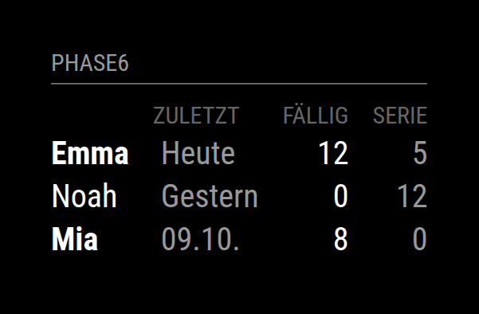

# MMM-phase6

A [MagicMirror²](https://magicmirror.builders) module that shows how your children are doing on [phase6](https://www.phase-6.de): when they last learned, how many words are due, and their streak, the days in a row they learned.



The module logs in to phase6 with your login and reads the page Meine Familie › Übersicht. A name is bold while words are due. The module is not from phase6 and may stop working when phase6 changes its website. Use it at your own risk, see the [terms of phase6](https://www.phase-6.de/agb.html).

## Installation

The module requires MagicMirror² 2.38.0 or newer. Clone it into the `modules` directory of MagicMirror²:

```shell
cd ~/MagicMirror/modules
git clone https://github.com/ms-zone-41/MMM-phase6
```

The module has no dependencies, so there is nothing to install with npm. Add it to your configuration, see below, and restart MagicMirror².

## Update

```shell
cd ~/MagicMirror/modules/MMM-phase6
git pull
```

Then restart MagicMirror².

## Configuration

The module needs the login of the parent on phase6, the one that shows your children under Meine Familie. MagicMirror² sends `config.js` to every browser that shows the mirror, so put the login into `config/config.env`. Keep `SECRET_` at the start of the names: MagicMirror² hides only those from the browsers.

```shell
SECRET_PHASE6_USERNAME="parent@example.com"
SECRET_PHASE6_PASSWORD="your password"
```

In the password, write `$$` for each `$`. A password with `"` or `\` does not work there: change it on phase6. Then add the module to the `modules` array in `config/config.js`:

```js
	{
		module: "MMM-phase6",
		position: "top_left",
		header: "phase6",
		config: {
			username: "${SECRET_PHASE6_USERNAME}",
			password: "${SECRET_PHASE6_PASSWORD}"
		}
	},
```

### Options

| Option | Description | Default |
| --- | --- | --- |
| `username` | The e-mail address of the login. | |
| `password` | The password of the login. | |
| `profiles` | The profiles to show, in this order, by their first name or their full name on phase6, e.g. `["Emma", "Noah"]`. The module shows each name as you write it. Add your own first name to show your own profile too. | The children, by their first name |
| `dueAdjustments` | A number to add to the due words of a profile, by its name as in `profiles`, e.g. `{ Emma: -1 }` if phase6 counts a word as due that cannot be learned. | `{}` |
| `updateInterval` | The time between two updates, in milliseconds, at least one minute. | `10 * 60 * 1000` (10 minutes) |

To hide a column, add a rule to `config/custom.css`, e.g. `.MMM-phase6 .p6-streak { display: none; }` for the streak. The other columns are `p6-last` and `p6-due`.

## Messages

The module shows a message above the profiles when something is wrong, and the log of MagicMirror² says more. While a message shows, the profiles of the last update that worked stay, dimmed. After a change of the configuration, restart MagicMirror².

| Message | What to do |
| --- | --- |
| … is missing in … | Add the login, see [Configuration](#configuration). |
| phase6 rejected the login | Check the login at [phase-6.de](https://www.phase-6.de) and correct it. Until MagicMirror² restarts, the module does not try again, so that phase6 does not lock the account. |
| phase6 is not reachable | Nothing: the module tries again every minute. If the message stays, check the internet connection of the mirror. |
| phase6 shows no family members | Use the login of the parent, see [Configuration](#configuration). If you do, phase6 may have changed its website: [update](#update) the module, or [report it](https://github.com/ms-zone-41/MMM-phase6/issues). |
| phase6 has no profile … | Correct the name in `profiles` or `dueAdjustments`. The message lists the profiles that phase6 has. |
| Check logs for more details. | [Report it](https://github.com/ms-zone-41/MMM-phase6/issues), with the lines of MMM-phase6 in the log. |

## Development

Run the tests and [ESLint](https://eslint.org) in the module directory:

```shell
npm install
node --run test
node --run lint
```

The tests read [tests/fixtures/parent.html](tests/fixtures/parent.html), a copy of the page Meine Familie › Übersicht with invented names. When phase6 changes the page, replace it with the new page, and give it the invented names, e-mail addresses, IDs and numbers of the old one, which the tests expect.

## License

MIT, see [LICENSE](LICENSE). 100% vibe coded: the module was created entirely with AI-assisted development.
